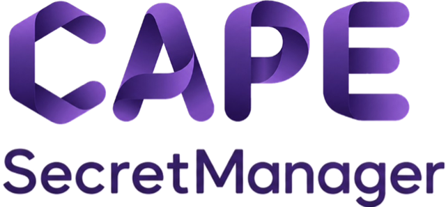
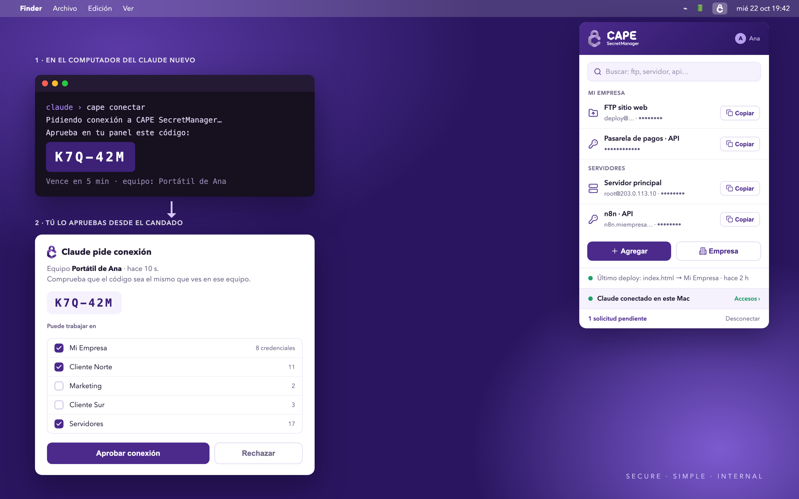

<p align="center">
  <picture>
    <source media="(prefers-color-scheme: dark)" srcset="docs/img/logo-blanco.png">
    
  </picture>
</p>

<p align="center">
  <b>Las claves de tu empresa en tu propio servidor.<br>Tu IA las usa sin verlas nunca.</b>
</p>

<p align="center">
  
  
  
  
  
</p>

<p align="center">
  
</p>

---

## Empieza aquí

Abre este repo con tu IA (Claude Code, OpenCode, Codex…) y pega **una** de estas frases:

| Tu caso | Dile a tu IA |
|---|---|
| **Mi equipo ya tiene servidor** (me invitaron) | «Instala la app de CAPE SecretManager y conecta esta IA. La Puerta es `https://puerta.…`» |
| **Quiero montar el mío** desde cero | «Monta el servidor de CAPE SecretManager siguiendo el README, y luego la app» |
| **Solo conectar otra IA** en este computador | «Conecta esta IA a CAPE SecretManager (docs/3-ia.md)» |

La IA hace el trabajo y se detiene solo cuando te toca a ti: instalar algo con permiso de
administrador, escanear un QR, aprobar un código o escribir tu contraseña. **Nunca te pedirá que le
pegues una clave.**

---

## Cómo funciona

```
   Tú y tu equipo                          Tu servidor (Docker)                    Tu IA
 ┌──────────────────┐  clave + 2FA   ┌────────────────────────────────┐  código  ┌─────────────────┐
 │  App de la barra │ ─────────────▶ │  Puerta  ──▶  Vaultwarden      │ ◀─────── │  cliente «cape» │
 │  Mac · Windows   │  ver, copiar,  │  (API)        (la bóveda)      │  pide    │  ssh · api · ftp│
 │                  │  aprobar IAs   │    └─ usa la clave y devuelve  │ ACCIONES │  nunca ve claves│
 └──────────────────┘                │       solo el resultado        │          └─────────────────┘
                                     └────────────────────────────────┘
```

<table>
<tr>
<td width="50%" valign="top">

### 🔐 Para las personas
- Candado en la barra (o **⌘⇧K** / **Ctrl+Shift+K**)
- Buscar y **copiar**: se borra del portapapeles a los 30 s
- Agregar claves y empresas o clientes
- Invitar personas con un código y un QR
- Contraseña + código de 6 dígitos; 5 intentos y se bloquea

</td>
<td width="50%" valign="top">

### 🤖 Para las IAs
- Se conectan con un código que **una persona aprueba**
- Solo ven las **empresas** que les dieron
- Piden **acciones**: SSH, API, subir y bajar por FTP
- La clave nunca sale del servidor; lo que se cuela en una respuesta, sale tapado
- Todo queda en el **historial**; se desconectan con un clic

</td>
</tr>
</table>

---

## Las guías

| | Guía | Quién | Cuándo |
|---|---|---|---|
|  | [**1 · Servidor**](docs/1-servidor.md): bóveda + Puerta | quien administra | una vez por empresa |
|  | [**2 · App**](docs/2-app.md): construir e instalar en Mac o Windows | cada persona | una vez por computador |
|  | [**3 · IA**](docs/3-ia.md): conectar Claude, OpenCode… | cada persona | una vez por computador |
|  | [**4 · Uso diario**](docs/4-uso.md) y qué hacer si algo falla | todos | siempre |
|  | [**5 · Actualizar**](docs/5-actualizar.md): cambios, Mac ↔ Windows, servidor | quien cambie algo | en cada mejora |

> **¿Por qué la app no se descarga hecha?** Porque se construye en tu computador desde este código:
> sabes exactamente qué estás instalando, y apunta a **tu** servidor y a ningún otro. Tarda unos 10 minutos la primera vez.

---

## Qué hay en el repo

```
servidor/vaultwarden/   la bóveda: Docker, marca CAPE (estilos y correos), respaldo cifrado
servidor/puerta/        la Puerta: Node 22 sin dependencias · pruebas con «node --test»
app/                    la app de la barra: Tauri 2 (Rust + HTML)
cliente/cape            el cliente para la IA (bash; en Windows, Git Bash)
docs/                   las cuatro guías
```

## Licencia

Gratis y de código abierto, con licencia [MIT](LICENSE): úsalo, cámbialo y compártelo libremente.
No se distribuye ya compilada a propósito: cada quien la construye apuntando a **su** servidor.

<p align="center"><sub>SECURE · SIMPLE · INTERNAL</sub></p>
